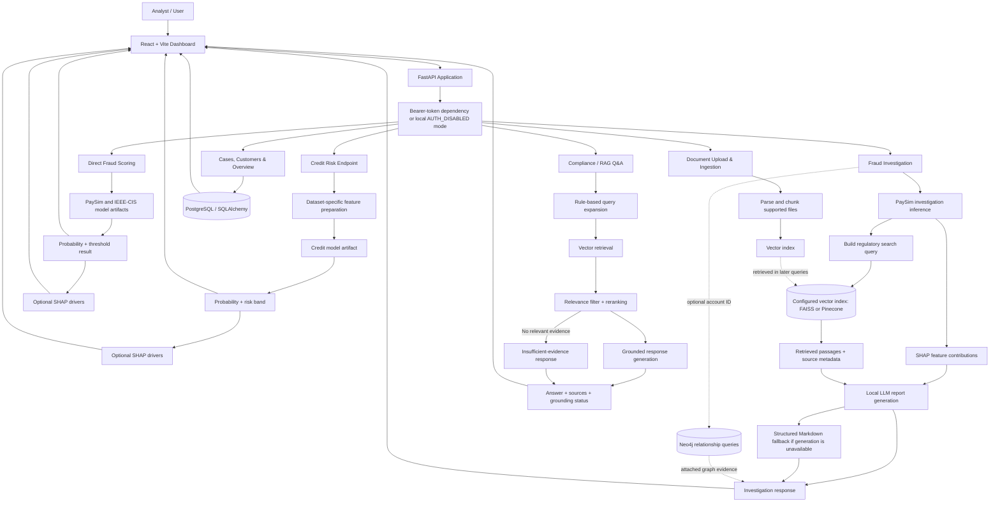
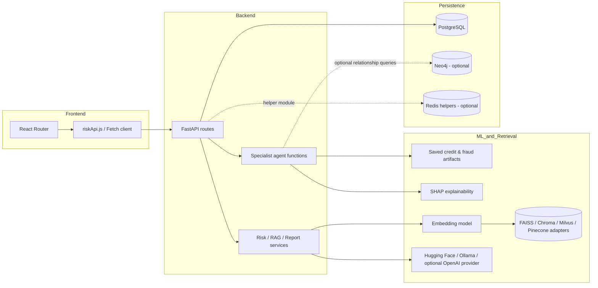

# AI Financial Risk Intelligence Platform

<p align="center">
  <strong>Risk Scoring · Explainable AI · Regulatory RAG · Relationship Analysis</strong>
</p>

<p align="center">
  
  
  
  
  
  
  
  
</p>

A financial-risk **decision-support prototype** that brings credit-risk scoring, transaction-fraud analysis, retrieval-backed financial Q&A, and analyst-facing case workflows into one application.

The platform combines a **React + Vite dashboard**, **FastAPI backend**, saved ML artifacts, document retrieval, PostgreSQL-backed operational data, and optional Neo4j relationship queries. It is intended to help analysts review model signals and supporting evidence—not to make autonomous lending, fraud, or regulatory decisions.

> **Implementation note:** This README describes the repository's verified application paths. Some modules are available as utilities but are not fully connected to the primary request flow. In particular, the main compliance RAG path is vector-based; Neo4j graph functionality is implemented but only partially integrated.

---

## Contents

- [Visual system workflow](#visual-system-workflow)
- [Platform capabilities](#platform-capabilities)
- [Architecture](#architecture)
- [Technology stack and logos](#technology-stack-and-logos)
- [Core workflows](#core-workflows)
- [Repository layout](#repository-layout)
- [Run the application](#run-the-application)
- [Configuration and services](#configuration-and-services)
- [API overview](#api-overview)
- [Machine learning and explainability](#machine-learning-and-explainability)
- [RAG and graph capabilities](#rag-and-graph-capabilities)
- [Testing and CI](#testing-and-ci)
- [Limitations and roadmap](#limitations-and-roadmap)
- [Responsible use](#responsible-use)

---

## Visual system workflow

The diagram illustrates the principal user-facing paths. Credit scoring, direct fraud scoring, fraud investigation, and compliance Q&A are separate backend workflows; they do not all pass through one universal agent pipeline.



### Workflow at a glance

1. The user submits a credit, fraud, investigation, compliance, or document request through the dashboard.
2. FastAPI validates the request and dispatches it to the corresponding route.
3. The selected ML path prepares its features and returns a model score or class.
4. Where available, SHAP provides feature-contribution information for analyst review.
5. Investigation and compliance paths retrieve financial/regulatory passages and return source-aware responses.
6. Results appear in the dashboard; operational case/customer data is handled through PostgreSQL-backed routes.

---

## Platform capabilities

| Capability | Description |
|---|---|
| Credit-risk scoring | Scores Taiwan and Lending Club applicant inputs with dataset-specific artifacts and feature preparation. |
| Fraud scoring | Runs direct PaySim and IEEE-CIS model inference, returning probability, threshold-based result, and optional SHAP information. |
| Fraud investigation | Combines PaySim inference, SHAP drivers, regulatory-document retrieval, and Markdown report generation with a structured fallback. |
| Compliance Q&A | Expands a question, retrieves and filters vector-indexed passages, reranks evidence, and generates an answer with source information. |
| Document ingestion | Parses supported document formats, creates chunks, and indexes them for retrieval. |
| Relationship analysis | Uses Neo4j graph queries for customer/account/transaction relationships; optional graph evidence can be attached to fraud investigation when an account ID is provided. |
| Analyst dashboard | Provides overview, runtime, cases, credit, fraud, compliance, customer, and document pages. |

---

## Architecture



### Architecture distinctions

- Direct fraud scoring is an inference path; it does not perform document retrieval or LLM report generation.
- Fraud investigation is a separate path that adds retrieval and report creation.
- The primary compliance/RAG service uses vector retrieval. Graph/vector hybrid utilities exist, but graph evidence is not consistently fused into the primary RAG prompt.
- The multi-agent layer is deterministic Python dispatch and specialist functions. A LangGraph state-machine workflow is not implemented in the inspected source.
- The API report output is Markdown; a PDF-rendering endpoint is not present in the active application path.

---

## Technology stack and logos

Logos are provided through [Skill Icons](https://skillicons.dev) and technology badges. Some technologies below are optional, adapter-based, or used in utility modules rather than every active request.

### Stack overview

<p align="center">
  
</p>

| Layer | Technologies |
|---|---|
| Frontend | React, React Router, Vite, Recharts, Framer Motion, Lucide icons, JavaScript, CSS |
| API/backend | Python, FastAPI, Pydantic, SQLAlchemy |
| Machine learning | scikit-learn, XGBoost, pandas, NumPy, joblib, pickle model artifacts |
| Explainability | SHAP |
| RAG / document processing | LangChain document abstractions/loaders, Hugging Face embeddings, retrieval and reranking utilities |
| Embedding / reranking models | `BAAI/bge-small-en-v1.5`; `cross-encoder/ms-marco-MiniLM-L-6-v2` |
| Vector stores / adapters | FAISS, Chroma, Milvus, Pinecone; defaults vary by code path |
| Graph | Neo4j driver and Cypher query utilities |
| LLM providers | Hugging Face generation, Ollama HTTP API, optional OpenAI provider |
| Database / helpers | PostgreSQL, Redis utility module |
| Development / CI | Git, GitHub, Docker, Docker Compose, GitHub Actions, pytest, Qlty coverage upload |

### Individual technology badges

<p>
  
  
  
  
  
  
  
  
  
  
  
  
  
  
  
  
  
  
</p>

---

## Core workflows

### 1. Credit risk

`POST /predict/credit-risk`

- Accepts a dataset key (`taiwan` or `lending_club`) and applicant fields.
- Loads the dataset-specific saved artifact and prepares the expected feature columns.
- Uses the positive-class probability as the risk score.
- Applies code-defined bands: **HIGH ≥ 0.50**, **MEDIUM ≥ 0.25**, otherwise **LOW**.
- Attempts to attach SHAP feature contributions.

A high or medium band recommends review. The application does not approve or decline a loan automatically.

### 2. Direct fraud scoring

`POST /predict/fraud-models`

- Scores PaySim and IEEE-CIS inputs using their respective saved artifacts.
- PaySim derives time, balance-difference, zero-balance, ratio, and transaction-type features.
- IEEE-CIS uses its model schema and saved categorical encoders.
- Returns model status, probability, threshold-based risk result, and optional SHAP drivers.
- An incompatible or unavailable model can be represented as a per-model result rather than silently treated as a successful score.

This route is intentionally separate from the investigation/RAG flow.

### 3. Fraud investigation

`POST /investigation` or `POST /predict/fraud`

1. Build PaySim features and calculate the fraud probability.
2. Attempt SHAP feature attribution.
3. Form a regulatory search query using transaction and model information.
4. Retrieve supporting passages from the configured FAISS or Pinecone index.
5. Generate an analyst-facing Markdown report with the selected generator.
6. Use a structured report fallback if generation is unavailable or unusable.
7. If an account ID is supplied, optionally attach Neo4j fan-in/fan-out evidence.

Graph evidence is attached as optional investigation evidence; it is not merged into the regulatory LLM prompt in the verified route.

### 4. Compliance / RAG Q&A

`POST /compliance/query` or `POST /rag/query`

1. Expand the user question into a limited set of related queries.
2. Search the configured vector backend.
3. Remove duplicate chunks and apply a heuristic relevance filter.
4. Rerank candidate passages using a cross-encoder or keyword fallback.
5. Generate an answer using retrieved context and source metadata.
6. Apply response checks and fallback behavior.
7. Return an explicit insufficient-evidence response when relevant evidence is not found.

Grounding checks are heuristic; they do not guarantee semantic entailment. Retrieved sources should be reviewed by a human.

---

## Repository layout

```text
.
├── frontend/                  # React + Vite dashboard
│   └── src/
│       ├── components/        # Reusable UI components
│       ├── hooks/             # React hooks
│       ├── pages/             # Overview, cases, credit, fraud, compliance, etc.
│       └── services/           # Frontend API client
├── src/
│   ├── agents/                 # Supervisor and specialist functions
│   ├── api/                    # FastAPI app, routes, schemas, auth, middleware
│   ├── database/               # SQLAlchemy models, PostgreSQL and Redis helpers
│   ├── embeddings/              # Embedding model and chunk pipeline
│   ├── evaluation/              # Evaluation utilities
│   ├── graph_rag/               # Neo4j graph builder and query utilities
│   ├── ingestion/               # File parsers and loaders
│   ├── llm/                     # Provider factory, prompts, response helpers
│   ├── ml_models/               # Credit, fraud, explainability, forecasting
│   ├── preprocessing/           # Feature engineering and document chunking
│   ├── retriever/               # Search, reranking, query rewrite utilities
│   ├── services/                # Investigation, RAG, reports, document ingestion
│   └── vectordb/                # Vector-store adapters and retrieval
├── models/                     # Saved model and supporting artifacts
├── data/                       # Dataset and document folders
├── vector_store/                # Local vector index assets (where present)
├── scripts/                    # Training, evaluation, ingestion, indexing, utilities
├── notebooks/                  # Experiments and prototypes
├── tests/                      # Python unit tests
├── run_project.py              # One-command application launcher
├── requirements.txt
├── Dockerfile
├── docker-compose.yml
└── .github/workflows/ci.yml
```

---

## Run the application

### Start the entire project with one command

The project launcher is intended to start the backend and frontend from the repository root. Once the project dependencies, model artifacts, and required local configuration are available, run:

```bash
python run_project.py
```

**That is the application startup command.** You do not need to manually run Uvicorn and Vite in separate terminals.

> Run this command from the project root—the directory containing `run_project.py`.

### First-time setup

A one-command launcher starts the application; it does not necessarily install every dependency or download every model/data artifact. Before the first run:

1. Clone the repository and enter its root folder.
2. Use the Python version supported by the project (Python 3.11 is the documented baseline).
3. Install the dependencies listed in `requirements.txt` and the frontend package dependencies if the launcher does not perform setup automatically.
4. Make sure required model files are present. If the repository uses Git LFS, install Git LFS and pull the tracked artifacts.
5. Configure any required database, vector-store, or LLM settings for the features you plan to use.

Example clone and dependency setup:

```bash
git clone https://github.com/Abhishek4209/AI-Financial-Risk-Intelligence-Platform-using-Graph-RAG-Multi-Agent-LLM.git
cd AI-Financial-Risk-Intelligence-Platform-using-Graph-RAG-Multi-Agent-LLM

git lfs install
git lfs pull

python -m pip install --upgrade pip
pip install -r requirements.txt

cd frontend
npm ci
cd ..
```

Then launch:

```bash
python run_project.py
```

### Local URLs

The exact ports are determined by the launcher configuration. When the application starts, use the URLs printed in the terminal. Common development endpoints are:

- Frontend: the Vite local URL printed by the launcher (often `http://localhost:5173`)
- Backend API docs: `http://127.0.0.1:8000/docs`
- Backend health: `http://127.0.0.1:8000/health`

If your launcher uses different ports, its terminal output is the source of truth.

### Stop the application

Use **Ctrl + C** in the terminal running `run_project.py`. If the launcher opens separate child processes, follow any shutdown message printed by the script.

---

## Configuration and services

Runtime behavior is controlled primarily by environment variables and Python defaults. The checked-in YAML configuration files were empty in the reviewed checkout, so do not assume they provide active settings.

| Component | Notes |
|---|---|
| Authentication | JWT bearer dependency; `AUTH_DISABLED=true` is a local-development bypass. |
| PostgreSQL | Used by operational overview, case, and customer routes. |
| Redis | Helper functions exist, but current business routes do not wire them into the main request flow. |
| Neo4j | Supports graph relationship queries; optional in fraud investigation when an account ID is supplied. |
| Vector store | Backend selection varies by path. General vector adapter defaults to FAISS; investigation retrieval uses a separate setting and supports FAISS/Pinecone. |
| LLM provider | Hugging Face/Ollama options are present; an optional OpenAI provider is also available through configuration. |

**Secrets:** Never commit real API keys or credentials. If a credential has been committed, revoke or rotate it and replace it with a clearly fake placeholder in example files.

---

## API overview

| Endpoint | Method | Purpose |
|---|---|---|
| `/health` | GET | Process-level health response |
| `/ready` | GET | Checks configured dependencies |
| `/predict/credit-risk` | POST | Credit-risk score and risk band |
| `/predict/fraud-models` | POST | Direct PaySim / IEEE-CIS model scoring |
| `/predict/fraud-models/ieee-cis/schema` | GET | IEEE-CIS feature schema |
| `/predict/fraud` | POST | Fraud investigation path |
| `/investigation` | POST | Investigation response and report |
| `/rag/query` | POST | Retrieval-backed question answering |
| `/compliance/query` | POST | Compliance-oriented RAG response |
| `/api/documents` | POST | Upload and index a supported document |
| `/api/overview` | GET | Dashboard aggregates |
| `/api/cases` | GET / POST | List or create cases |
| `/api/cases/{case_id}` | GET | Fetch a case |
| `/api/customers` | GET / POST | List or create customers |
| `/api/customers/{customer_id}` | GET | Fetch a customer |

See the interactive API documentation at `/docs` while the backend is running for request and response schemas.

---

## Machine learning and explainability

### Model inputs

- **Credit:** Taiwan and Lending Club use separate artifacts and feature-preparation logic.
- **PaySim fraud:** Transaction step/type, amount, origin balances, and destination balances are transformed into model features.
- **IEEE-CIS fraud:** Uses its saved feature schema and categorical encoders; raw preprocessing fields may be required to derive model inputs.

### Explainability

SHAP is used where supported to provide feature-contribution information. SHAP values are **not causal explanations** and should be interpreted with the model, input data, and explainer assumptions in mind.

### Evaluation

The repository includes training and evaluation utilities, notebooks, and saved metric reports. Reported metrics are artifact/report-specific; they should not be interpreted as proof of current performance on a live financial institution's population. Independent validation, calibration, fairness testing, temporal evaluation, and model governance are outside the demonstrated active workflow.

---

## RAG and graph capabilities

### Retrieval-Augmented Generation

The RAG path uses document chunks, embeddings, vector search, relevance filtering, reranking, and a generation step. Source metadata is returned to help reviewers trace the response to retrieved material.

The active path uses rule-based query expansion, vector retrieval, duplicate removal, heuristic relevance filtering, and cross-encoder reranking when available. Some BM25, hybrid retrieval, rewrite, and parent-child utilities exist separately and are not all invoked by the primary compliance request path.

### Graph relationship analysis

Neo4j graph utilities model:

- `Customer`
- `Account`
- `Transaction`
- `Document`

Relationship types include ownership, sending/receiving, and document association. Cypher utilities support connected-customer, fan-in, fan-out, transaction-chain, and customer-document queries.

**Graph integration status:** Graph schema and query utilities are implemented, and optional graph evidence can be attached in the fraud investigation path. The document upload path does not currently populate the Neo4j document graph, and the main compliance RAG response pipeline does not consistently combine graph evidence with vector evidence.

---

## Testing and CI

The repository includes Python unit tests and a GitHub Actions workflow. Configured CI checks include:

- Python compilation
- YAML and Docker Compose validation
- pytest with coverage
- Frontend dependency installation and Vite build
- Docker image build

Run the Python test suite from the repository root:

```bash
pytest tests --cov=src
```

A passing unit suite is not equivalent to end-to-end financial-system validation, model fairness certification, production SLO validation, or confirmation that external services are available.

---

## Limitations and roadmap

The current repository should be treated as a **prototype / decision-support application**. Key areas to address before production use include:

- Complete browser authentication and authorization; the frontend currently does not attach a bearer token.
- Align readiness checks with the services actually provisioned in the deployment.
- Integrate and validate graph evidence in the main retrieval/answer context if full Graph RAG is a goal.
- Align accepted upload extensions between the UI and API parser.
- Add robust source-grounding evaluation beyond lexical heuristics.
- Establish model calibration, fairness, temporal validation, governance, and monitoring.
- Add database migrations, secrets management, observability, and deployment manifests.
- Add a real PDF report renderer if downloadable PDF output is required.
- Review overview fallback behavior so server errors cannot be confused with sample dashboard data.
- Validate dataset licenses, artifact provenance, and feature preprocessing consistency.

---

## Responsible use

This project is intended for educational, experimentation, and analyst decision-support purposes.

- A model score is an estimate—not proof of fraud, default, or wrongdoing.
- A threshold-based **HIGH** result is a review signal, not an automatic block, rejection, or filing.
- SHAP contributions are not causal explanations.
- Generated answers and summaries can be wrong; verify claims against source documents.
- Do not use the prototype as the sole basis for consequential financial decisions.
- Protect personal and financial data and use only authorized datasets.

---

## Acknowledgements

Built with open-source machine-learning, API, frontend, retrieval, and graph technologies. Dataset and model use should follow their respective licenses and terms.

https://youtu.be/11UKPFmocrg?si=CObc_M79t1PjDYOp
